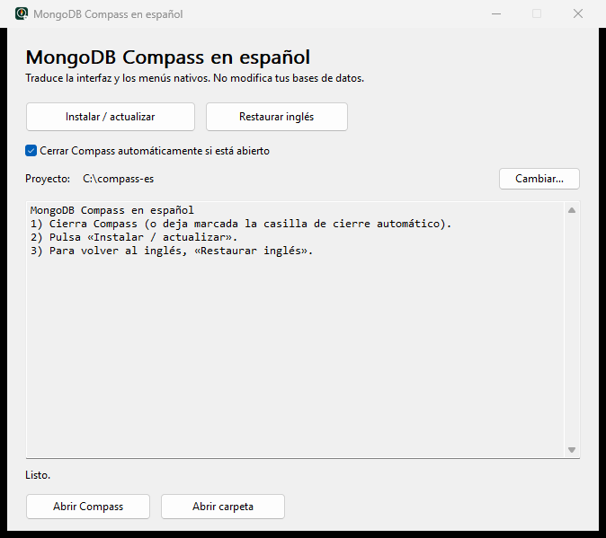
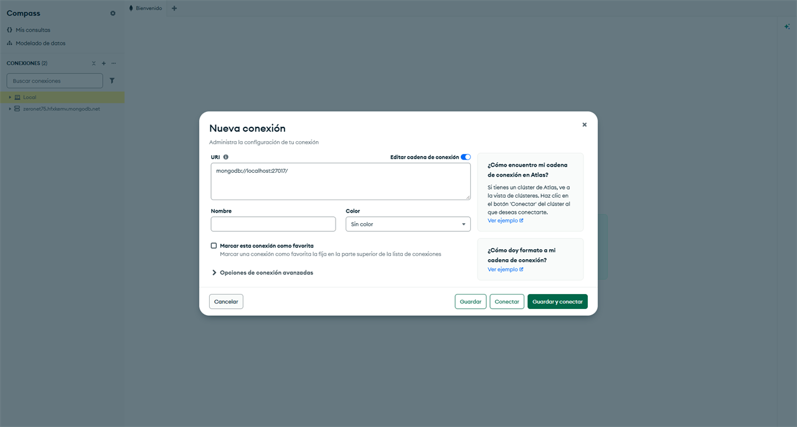
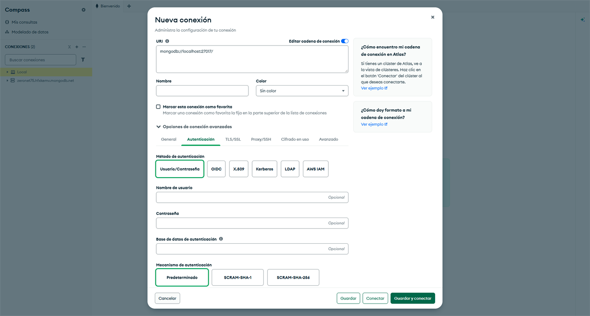
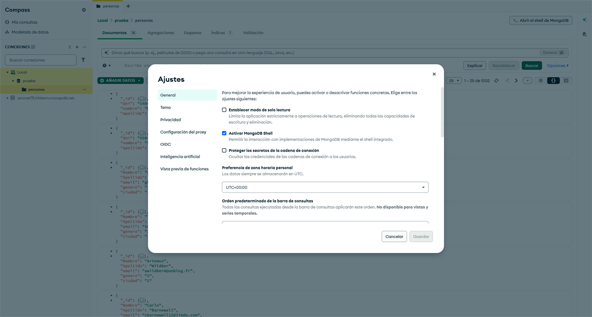

# MongoDB Compass en español

Traduccion al español de la interfaz de **MongoDB Compass para Windows**, sin tocar el codigo de MongoDB: una capa que se aplica sobre la aplicacion instalada (Electron/React) y un pequeno programa en **C++** para instalarla o quitarla con un clic.



- Probado con **MongoDB Compass 1.53.3** en Windows 11 x64.
- **No** modifica bases de datos, documentos ni el comportamiento de Compass: solo los textos de la interfaz.
- Incluye traduccion de la **barra de menus nativa** (Conexiones, Editar, Ver, Ayuda y submenus) y de los **dialogos** de salida y actualizaciones.
- No requiere administrador ni instalar Node.js.

## Caracteristicas

- Traduccion en tiempo de ejecucion: pantalla de bienvenida, barra lateral, formulario de conexion (General, Autenticacion, TLS/SSL, Proxy/SSH, Cifrado en uso, Avanzado), ajustes completos, bases de datos y colecciones, Documentos, Agregaciones, Esquema, Indices, Validacion, barra de consultas, menus y dialogos.
- Diccionario de **545 entradas** y 20 reglas para frases dinamicas (contadores, "Connected to X", "1 - 25 of 1002"...).
- Interfaz grafica en C++ (Win32 puro, sin dependencias) para instalar, restaurar, abrir Compass y ver el registro.
- Copia de seguridad automatica del `app.asar` original y script de reversion.
- Actualizable: se vuelve a aplicar tras cada actualizacion de Compass.

## Inicio rapido

1. Descarga el repositorio (**Code → Download ZIP**) y descomprimelo donde quieras.
2. Cierra MongoDB Compass (o deja marcada la casilla de cierre automatico).
3. Ejecuta **`CompassES.exe`** y pulsa **Instalar / actualizar**.

Listo: abre Compass y lo veras en español.

Si lo prefieres sin interfaz grafica, haz doble clic en **`instalar.bat`**.

## Requisitos

- **Windows 10/11 x64**.
- **MongoDB Compass** instalado (instalacion normal por usuario, en `%LOCALAPPDATA%\MongoDBCompass`).
- **Node.js**: no hay que instalarlo. El repositorio no incluye `node.exe` por su tamano (90 MB): el instalador descarga una copia portable de Node 24.22.3 LTS la primera vez que se ejecuta. Si ya hay Node en el sistema, tambien vale.
- PowerShell y conexion a Internet (solo la primera vez, para descargar Node).
- No requiere permisos de administrador para la instalacion por usuario.

Si Compass esta instalado para todos los usuarios:

```powershell
.\install-compass-es.ps1 -BasePath "C:\Program Files\MongoDB Compass"
```

## Uso

### Interfaz grafica

| Boton | Funcion |
| --- | --- |
| **Instalar / actualizar** | Aplica la traduccion (cierra Compass si la casilla esta marcada). |
| **Restaurar ingles** | Vuelve al `app.asar` original. |
| **Cambiar...** | Elige otra carpeta del proyecto. |
| **Abrir Compass** | Lanza MongoDB Compass. |
| **Abrir carpeta** | Abre la carpeta del proyecto en el Explorador. |

El registro muestra la salida completa de PowerShell y el codigo de salida.

### Archivos .bat

- `instalar.bat` — instala o actualiza la traduccion.
- `restaurar.bat` — restaura el original en ingles.

Admiten argumentos, por ejemplo `instalar.bat -Force`.

### PowerShell

```powershell
# Instalar (cierra Compass si esta abierto)
.\install-compass-es.ps1 -Force

# Restaurar el original
.\restore-compass-es.ps1
```

## Capturas

| Formulario de conexion | Autenticacion | Ajustes |
| --- | --- | --- |
|  |  |  |

## Como funciona

MongoDB Compass **no tiene sistema de localizacion**: no usa i18next ni archivos de idioma, y todos los textos estan en ingles dentro de `resources\app.asar`.

1. Se comprobaron los *fuses* de Electron: `EnableEmbeddedAsarIntegrityValidation` esta desactivado, por lo que el ASAR se puede modificar sin que la aplicacion lo rechace.
2. Se inyecta `build/i18n-es.js` en `build/index.html`. Esa capa traduce nodos de texto y atributos visibles (`placeholder`, `title`, `aria-label`, `alt`) mediante un `MutationObserver`, de modo que React no revierte los cambios.
3. Las frases con partes variables se resuelven con reglas (expresiones regulares) en `build-i18n.js`.
4. El menu nativo se traduce con `build/menu-es.js`, que intercepta `Menu.buildFromTemplate` en el proceso principal.
5. Los dialogos nativos (salida con Ctrl+Q, actualizaciones, "Acerca de") se traducen parcheando sus cadenas en `build/463.js` y `build/main.js`.

La capa **no traduce** el contenido de documentos, el editor JSON, la consola ni los valores de formulario.

## Estructura del proyecto

| Archivo | Funcion |
| --- | --- |
| `CompassES.exe` | Interfaz grafica (C++/Win32) |
| `CompassES.exe.manifest` | Manifiesto de estilos visuales |
| `gui/CompassES.cpp` | Codigo fuente de la interfaz |
| `gui/build.bat` | Compila la interfaz con MSVC |
| `gui/app.rc` | Recurso del icono |
| `gui/compass-es.ico` | Icono de la aplicacion (16-256 px) |
| `gui/make-icon.ps1` | Genera el icono con GDI+ |
| `gui/make-ico.js` | Empaqueta los PNG en el `.ico` |
| `instalar.bat` / `restaurar.bat` | Lanzadores de doble clic |
| `install-compass-es.ps1` | Instalador (descarga Node si falta) |
| `install-compass-es.js` | Aplica los parches al ASAR |
| `restore-compass-es.ps1` | Restaura el original |
| `dict-es.json` | Diccionario ingles → español (545 entradas) |
| `build-i18n.js` | Genera `i18n-es.js` |
| `i18n-es.js` | Capa de traduccion de la interfaz |
| `menu-es.js` | Traduccion del menu nativo |
| `repack.js` | Lector/escritor del formato ASAR (sin dependencias) |
| `docs/` | Capturas para la documentacion |

## Actualizaciones de Compass

Squirrel instala cada version en una carpeta nueva `app-X.Y.Z` y elimina las antiguas. Tras una actualizacion, la traduccion deja de aplicarse: vuelve a ejecutar `CompassES.exe` o `instalar.bat`. El instalador detecta la version mas reciente automaticamente.

## Anadir o corregir traducciones

1. Edita `dict-es.json` (pares `"texto en ingles": "texto en español"`).
2. Regenera la capa:

```powershell
runtime\node\node.exe build-i18n.js
```

3. Reinstala con `CompassES.exe` o `instalar.bat`.

Las frases con partes variables estan en `build-i18n.js` (array `rules`). Las etiquetas del menu nativo, en `menu-es.js` (mapa `MAP`).

## Solucion de problemas

- **Compass sigue en ingles**: cierra Compass del todo y vuelve a ejecutar la instalacion; comprueba que se parcheo la carpeta `app-X.Y.Z` mas reciente.
- **"No se encuentra install-compass-es.ps1"**: el .exe debe estar junto a los scripts, o usa **Cambiar...** para indicar la carpeta.
- **Error al descargar Node.js**: comprueba la conexion o copia manualmente `node.exe` en `runtime\node\`.
- **El antivirus bloquea PowerShell o node.exe**: permite la ejecucion; son los mismos componentes que usa el instalador manual.
- **El menu nativo sigue en ingles**: reinicia Compass (el menu se construye al arrancar).
- **Quiero volver al ingles**: `restaurar.bat` o `restore-compass-es.ps1`.

## Licencia y aviso legal

- El codigo de este repositorio (capa de traduccion, scripts, interfaz y documentacion) se publica bajo **licencia MIT**; ver [LICENSE](LICENSE).
- **MongoDB Compass no se incluye ni se redistribuye**: es propiedad de MongoDB, Inc. y se distribuye bajo la **Server Side Public License (SSPL)**. Este proyecto solo modifica la copia instalada en el equipo del usuario, con su consentimiento.
- **Node.js** se distribuye bajo licencia MIT; su licencia se incluye en `runtime/node/LICENSE` cuando se descarga.
- Proyecto **no oficial**, sin afiliacion ni respaldo de MongoDB, Inc.

## Creditos

- Traduccion, scripts e interfaz: Juan Ramon Martin.
- MongoDB Compass: MongoDB, Inc.
- Node.js: OpenJS Foundation.
